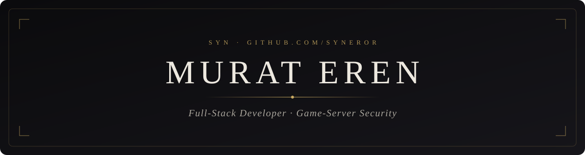

   

FULL-STACK DEVELOPER  ·  GAME-SERVER SECURITY

  

    

  
 
 I.  About

Break it, understand it, build it again.

I didn't learn programming as a school subject — I learned it out of necessity. When something broke in the community I was running, I wrote my own fix instead of hunting for a ready-made one. The first attempt was poor, the second was better, and by the third I could defend every decision behind it.

That habit stayed. I'm drawn to what users never see — why a service failed, how a system was deceived, why a page was slow — and I consider something understood only once I've built a tool with it that someone else can rely on.

 
 II.  Selected Work
<table> <tr> <td width="50%" valign="top">

nexshop  C#  ·  ASP.NET Core  ·  PostgreSQL

A commerce platform for digital goods — licence keys, secure delivery, Stripe & iyzico payments, live support and a complete administration panel.

</td> <td width="50%" valign="top">

syn-anticheat  Lua  ·  C#  ·  Next.js

Server-side cheat detection for FiveM. A Lua resource, an ASP.NET Core API and a Next.js dashboard, designed to operate as a single system.

</td> </tr> <tr> <td width="50%" valign="top">

chronos-atelier  Next.js  ·  React 19  ·  TypeScript

A scroll-driven study of a luxury mechanical watch — it separates into eight layers, each component explains itself, and the piece reassembles.

</td> <td width="50%" valign="top">

webportfolio  TypeScript  ·  Next.js  ·  Tailwind

Personal portfolio. All content driven from a single source file, light and dark themes, statically generated project pages.  Live ↗

</td> </tr> <tr> <td width="50%" valign="top">

syn-discord-bots  JavaScript  ·  discord.js

A Turkish-language suite of four Discord bots — moderation, tickets, team management and general utilities.

</td> <td width="50%" valign="top">

Adventure Time Portfolio  Next.js  ·  Design

A themed portfolio built as a design exercise — playful on the surface, the same engineering discipline underneath.

</td> </tr> </table>  
 III.  Toolkit
<table> <tr><td width="140"><b>LANGUAGES</b></td><td>C# &nbsp;·&nbsp; TypeScript &nbsp;·&nbsp; JavaScript &nbsp;·&nbsp; Lua &nbsp;·&nbsp; C++ &nbsp;·&nbsp; Rust</td></tr> <tr><td><b>BACKEND</b></td><td>ASP.NET Core &nbsp;·&nbsp; Node.js &nbsp;·&nbsp; PostgreSQL &nbsp;·&nbsp; SQLite</td></tr> <tr><td><b>FRONTEND</b></td><td>Next.js &nbsp;·&nbsp; React &nbsp;·&nbsp; Tailwind CSS</td></tr> <tr><td><b>PRACTICE</b></td><td>Clean Architecture &nbsp;·&nbsp; System Security &nbsp;·&nbsp; Anti-Cheat Design</td></tr> </table>  
 IV.  Contact

Open to collaboration and considered feedback. For a bug or an idea, open an issue on the relevant repository — or write directly to erenmrt46@gmail.com.

 

 © Murat &nbsp;·&nbsp; <i>Syn
