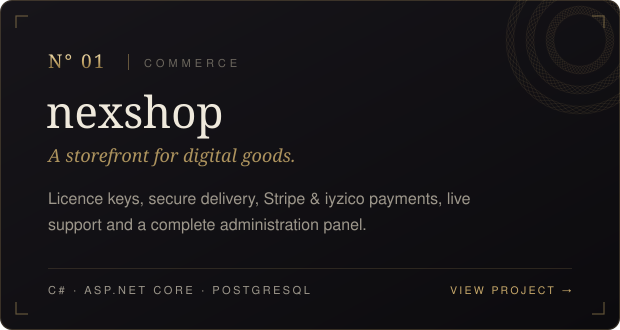
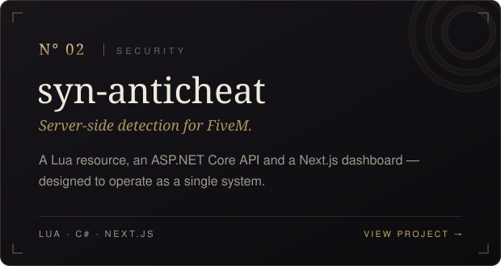
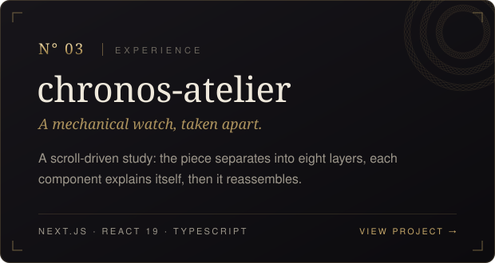
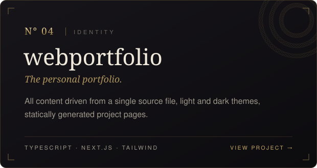
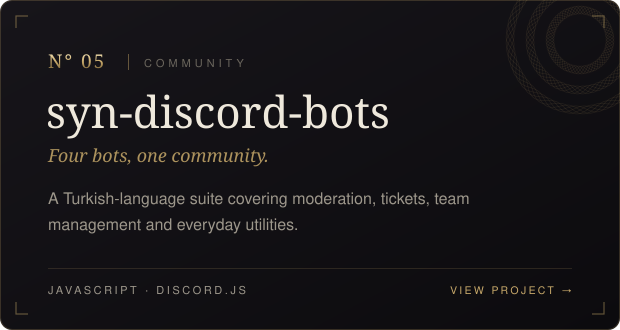
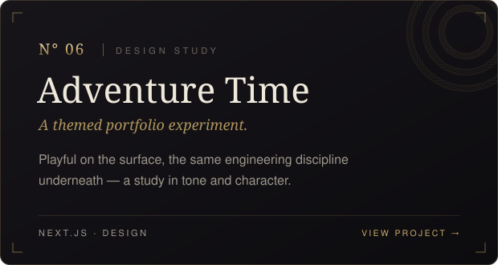
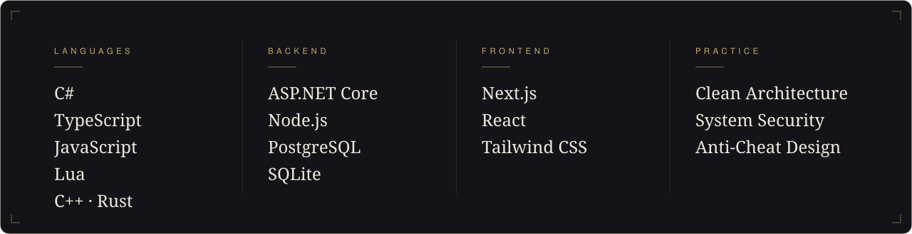
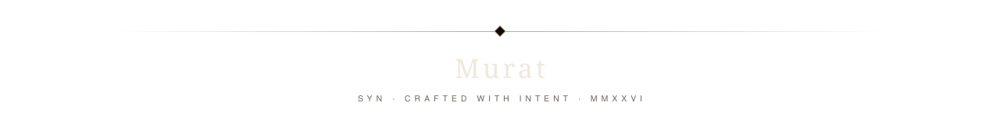

<!-- Murat · Syn — profile README. Assets are generated; dark & light variants switch with the viewer's GitHub theme. -->

  <picture><source media="(prefers-color-scheme: dark)" srcset="./assets/banner-dark.svg" /><source media="(prefers-color-scheme: light)" srcset="./assets/banner-light.svg" /></picture>

 

<picture><source media="(prefers-color-scheme: dark)" srcset="./assets/section-about-dark.svg" /><source media="(prefers-color-scheme: light)" srcset="./assets/section-about-light.svg" /></picture>

<picture><source media="(prefers-color-scheme: dark)" srcset="./assets/quote-dark.svg" /><source media="(prefers-color-scheme: light)" srcset="./assets/quote-light.svg" /></picture>

<table align="center"><tr><td width="820">
 

I didn't learn programming as a school subject — I learned it out of necessity. When something broke in the community I was running, I wrote my own fix instead of hunting for a ready-made one. The first attempt was poor, the second was better, and by the third I could defend every decision behind it.

That habit stayed. I'm drawn to what users never see — *why a service failed, how a system was deceived, why a page was slow* — and I consider something understood only once I've built a tool with it that someone else can rely on.

 
</td></tr></table>

 

<picture><source media="(prefers-color-scheme: dark)" srcset="./assets/section-work-dark.svg" /><source media="(prefers-color-scheme: light)" srcset="./assets/section-work-light.svg" /></picture>

  <a href="https://github.com/syNeror/nexshop"><picture><source media="(prefers-color-scheme: dark)" srcset="./assets/card-nexshop-dark.svg" /><source media="(prefers-color-scheme: light)" srcset="./assets/card-nexshop-light.svg" /></picture></a>
  <a href="https://github.com/syNeror/syn-anticheat"><picture><source media="(prefers-color-scheme: dark)" srcset="./assets/card-anticheat-dark.svg" /><source media="(prefers-color-scheme: light)" srcset="./assets/card-anticheat-light.svg" /></picture></a>

  <a href="https://github.com/syNeror/chronos-atelier"><picture><source media="(prefers-color-scheme: dark)" srcset="./assets/card-chronos-dark.svg" /><source media="(prefers-color-scheme: light)" srcset="./assets/card-chronos-light.svg" /></picture></a>
  <a href="https://github.com/syNeror/webportfolio"><picture><source media="(prefers-color-scheme: dark)" srcset="./assets/card-portfolio-dark.svg" /><source media="(prefers-color-scheme: light)" srcset="./assets/card-portfolio-light.svg" /></picture></a>

  <a href="https://github.com/syNeror/syn-discord-bots"><picture><source media="(prefers-color-scheme: dark)" srcset="./assets/card-bots-dark.svg" /><source media="(prefers-color-scheme: light)" srcset="./assets/card-bots-light.svg" /></picture></a>
  <a href="https://advanturetimeportfolio.vercel.app"><picture><source media="(prefers-color-scheme: dark)" srcset="./assets/card-adventure-dark.svg" /><source media="(prefers-color-scheme: light)" srcset="./assets/card-adventure-light.svg" /></picture></a>

 

<picture><source media="(prefers-color-scheme: dark)" srcset="./assets/section-toolkit-dark.svg" /><source media="(prefers-color-scheme: light)" srcset="./assets/section-toolkit-light.svg" /></picture>

<picture><source media="(prefers-color-scheme: dark)" srcset="./assets/toolkit-dark.svg" /><source media="(prefers-color-scheme: light)" srcset="./assets/toolkit-light.svg" /></picture>

 

<picture><source media="(prefers-color-scheme: dark)" srcset="./assets/section-contact-dark.svg" /><source media="(prefers-color-scheme: light)" srcset="./assets/section-contact-light.svg" /></picture>

  Open to collaboration and considered feedback. 
  For a bug or an idea, open an issue on the relevant repository — or write directly.

  <a href="https://muraterendmn.vercel.app"><picture><source media="(prefers-color-scheme: dark)" srcset="./assets/link-portfolio-dark.svg" /><source media="(prefers-color-scheme: light)" srcset="./assets/link-portfolio-light.svg" /></picture></a>
  &nbsp;
  <a href="mailto:erenmrt46@gmail.com"><picture><source media="(prefers-color-scheme: dark)" srcset="./assets/link-email-dark.svg" /><source media="(prefers-color-scheme: light)" srcset="./assets/link-email-light.svg" /></picture></a>
  &nbsp;
  <a href="https://github.com/syNeror?tab=repositories"><picture><source media="(prefers-color-scheme: dark)" srcset="./assets/link-github-dark.svg" /><source media="(prefers-color-scheme: light)" srcset="./assets/link-github-light.svg" /></picture></a>

<picture><source media="(prefers-color-scheme: dark)" srcset="./assets/footer-dark.svg" /><source media="(prefers-color-scheme: light)" srcset="./assets/footer-light.svg" /></picture>

